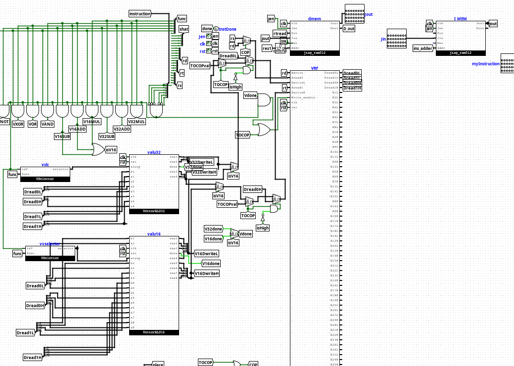

# CPU with Vector-Register Support

**A computer architecture course project built in Logisim-evolution.**

[](https://github.com/logisim-evolution/logisim-evolution)


This project extends a simulated CPU with a **128-bit vector register file**, lane-wise vector arithmetic, and vector instruction decoding. It was developed as a group project for a **Computer Architecture** course at Sharif University of Technology.

<p align="center">
  
  <br>
  <sub>Vector datapath and register-file circuitry (figure from the project report).</sub>
</p>

## At a glance

| Feature | Implementation |
| --- | --- |
| Simulator | **Logisim-evolution 3.9.0** (version recorded in the `.circ` file) |
| Vector register width | **128 bits** |
| Vector register file | **31 registers**, each represented by two 64-bit halves |
| Vector arithmetic | **4 × 32-bit** or **8 × 16-bit** parallel lanes |
| Operations | Vector addition, subtraction, multiplication, AND, OR, XOR, NOT |
| Scalar/vector transfers | `TOCOP` and `FROMCOP` |
| Design file | [`VPU.circ`](VPU.circ) |
| Technical report | [`Report.pdf`](Report.pdf) (Persian) |

## Repository contents

```text
.
├── VPU.circ                 # Complete Logisim-evolution circuit supplied for the project
├── Report.pdf               # Original course-project report (Persian)
├── assets/
│   └── vector-datapath.png # Circuit figure extracted from the report
├── docs/
│   └── architecture.md     # Additional architectural details and instruction encodings
├── .gitattributes
├── .gitignore
└── README.md
```

## Opening the circuit

1. Install [Logisim-evolution](https://github.com/logisim-evolution/logisim-evolution). The circuit file declares **version 3.9.0**; compatibility with other versions has not been verified here.
2. Download or clone this repository.
3. Open **`VPU.circ`** in Logisim-evolution (`File` → `Open`).
4. Select the **`main`** circuit to inspect the processor and its vector datapath. The `VectorALU16`, `VectorALU32`, `RegisterFile`, and `VSelector` subcircuits can be inspected separately.
5. Consult the report and [architecture notes](docs/architecture.md) for design decisions and instruction encodings.

> **Verification note:** The provided files have been checked for structure and documented specifications. The complete circuit has **not** been run through a functional simulation or regression-test suite as part of this repository preparation.

## Design overview

- **Register storage:** The implementation represents each 128-bit vector register using a pair of 64-bit registers and adapts register-file reads and writes accordingly.
- **Lane-wise execution:** Vector units reuse 32-bit scalar ALU components for four 32-bit lanes or eight 16-bit lanes (the latter with input extension and result truncation).
- **Control and selection:** Dedicated vector control logic selects ALU operations, handles write enable, and chooses between the 16-bit and 32-bit datapaths.
- **Register transfers:** `TOCOP` and `FROMCOP` support transfers between scalar and vector register storage.

For instruction/function codes and more implementation details, see **[Architecture notes](docs/architecture.md)**.

## Project team

The original course report credits the following contributors:

- Mohammad BaniAhmadi (محمد بنی‌احمدی)
- علیرضا علمی‌فرد
- محمدعلی مسیح
- علی نوری

**Course:** Computer Architecture · **Date:** July 2025

The authorship information above follows the supplied project report. The original PDF includes student identification numbers; please confirm that all contributors approve its public distribution before making the repository public.

## Licensing and reuse

No open-source license has been selected. Please contact the project contributors before redistributing or reusing the design. The absence of a license does not imply permission to reuse the files.
